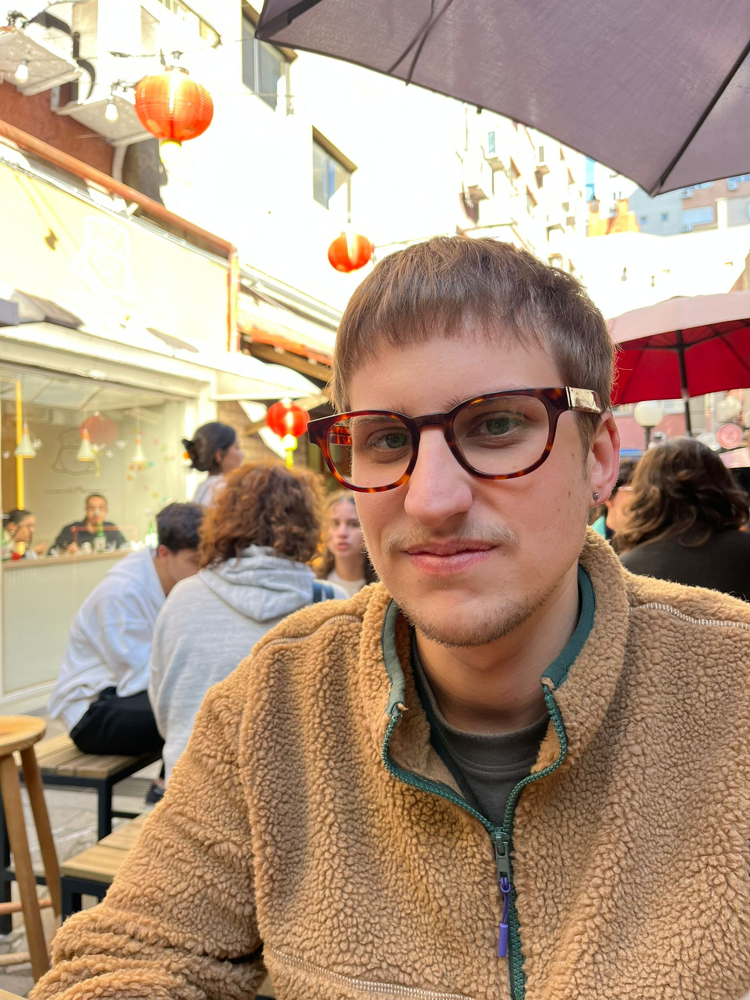

:::: {.about}

::: {.about-sidebar}

{.about-photo}

[Arthur Trein]{.about-name}

[MA student · UFRGS]{.about-tagline}

[[arthur.dexheimer@gmail.com](mailto:arthur.dexheimer@gmail.com)]{.about-email}

::: {.about-links}
<a href="https://orcid.org/0000-0003-4346-5636" aria-label="ORCID"></a>
<a href="https://lattes.cnpq.br/5477806158521328" aria-label="Lattes CV"></a>
<a href="https://www.researchgate.net/profile/Arthur-Trein" aria-label="ResearchGate"></a>
<a href="https://zenodo.org/search?q=metadata.creators.person_or_org.identifiers.identifier%3A%220000-0003-4346-5636%22" aria-label="Zenodo"></a>
:::

:::

::: {.about-text}

I am an MA student in Psycholinguistics at the Federal University of Rio Grande do Sul (UFRGS), Brazil, where I also earned my BA in Portuguese and English Languages and Literatures. 

I am supervised by [Dr. Ingrid Finger](https://bilingualismmindbrain.com/ingrid-finger-phd/) (UFRGS) and [Dr. Ronaldo Lima Jr.](https://ronaldolimajr.github.io) (UnB), and I am affiliated with the [Non-Native Phonology Laboratory (LAFONN)](https://www.ufrgs.br/lafonn/) and the [Bilingualism and Cognition Laboratory (LABICO)](https://www.ufrgs.br/labico/). 

My research focuses on the development of second language (L2) speech, particularly how new phonetic-phonological patterns emerge and change over time. I am also interested in quantitative analysis and in exploring statistical tools that do justice to how variable language development really is.

In Portuguese, I pronounce my name as [\[aɾˈtuɾ ˈtɾɐ̃j̃\]]{.ipa}. In English, you can pronounce it as [\[ˈɑɹθɚ ˈtɹaɪn\]]{.ipa} or however you feel comfortable!

:::

::::
